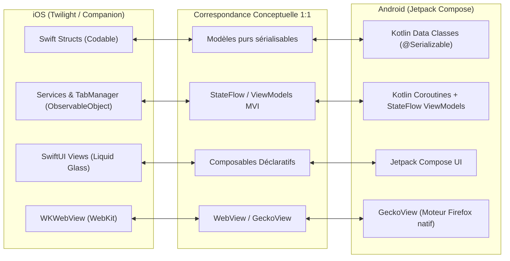

# Guide d'Architecture & Stratégie de Portage Android : Companion for Zen

Ce document détaille comment l'architecture mise en place pour **Companion for Zen (iOS)** a été spécifiquement conçue pour permettre un portage rapide, propre et direct vers **Android (Jetpack Compose & Kotlin Multiplatform)**.

---

## 1. Vue d'Ensemble de l'Équivalence d'Architecture

L'application suit scrupuleusement les principes de **Clean Architecture** et de flux unidirectionnel de données (**MVI / MVVM**). Aucune logique métier n'est couplée aux vues SwiftUI.



---

## 2. Correspondance des Modèles de Données (Domain)

Tous les modèles dans `CompanionForZen/Core/Models/` sont 100% découplés de tout framework UI.

| Modèle Swift (iOS) | Équivalent Kotlin (Android) | Rôle dans l'application |
| :--- | :--- | :--- |
| [`Tab.swift`](file:///Users/user/Documents/Twilight-iOS/CompanionForZen/Core/Models/Tab.swift) | `data class Tab` | Entité onglet (URL, titre, spaceId, isPinned, createdAt, lastAccessedAt, isArchived) |
| [`Space.swift`](file:///Users/user/Documents/Twilight-iOS/CompanionForZen/Core/Models/Space.swift) | `data class Space` | Espaces de travail Zen (nom, icône, couleur d'accent, ordre) |
| [`HistoryEntry.swift`](file:///Users/user/Documents/Twilight-iOS/CompanionForZen/Core/Models/HistoryEntry.swift) | `data class HistoryEntry` | Entité de l'historique de navigation |
| [`Bookmark.swift`](file:///Users/user/Documents/Twilight-iOS/CompanionForZen/Core/Models/HistoryEntry.swift) | `data class Bookmark` | Entité des favoris / marque-pages |
| [`DownloadItem.swift`](file:///Users/user/Documents/Twilight-iOS/CompanionForZen/Core/Models/DownloadItem.swift) | `data class DownloadItem` | Tâche de téléchargement (taille, statut, destination) |
| [`SearchEngine.swift`](file:///Users/user/Documents/Twilight-iOS/CompanionForZen/Core/Models/SearchEngine.swift) | `enum class SearchEngineType` | Moteurs de recherche supportés & formattage d'URL |
| [`AppSettings.swift`](file:///Users/user/Documents/Twilight-iOS/CompanionForZen/Core/Models/AppSettings.swift) | `data class AppSettings` | Préférences de l'application (archivage, bloqueur, langue) |

### Exemple de conversion Swift -> Kotlin

```swift
// Swift 6 (iOS)
public struct Tab: Identifiable, Codable {
    public let id: UUID
    public var url: URL
    public var title: String
    public var spaceId: UUID
    public var isPinned: Bool
    public var lastAccessedAt: Date
    public var isArchived: Bool
}
```

```kotlin
// Kotlin (Android)
@Serializable
data class Tab(
    val id: String = UUID.randomUUID().toString(),
    val url: String,
    val title: String = "Nouvel onglet",
    val spaceId: String,
    val isPinned: Boolean = false,
    val lastAccessedAt: Long = System.currentTimeMillis(),
    val isArchived: Boolean = false
)
```

---

## 3. Correspondance des Services & Gestion d'État

| Service iOS | Architecture Android Recommandée | Détails |
| :--- | :--- | :--- |
| **`TabManager`** | `TabRepository` + `TabsViewModel` | Gère les listes `tabsState: StateFlow<TabsState>`, l'auto-archivage périodique via `WorkManager`. |
| **`FirefoxSyncService`** | `Mozilla Android Components` (`service-fxa`) | **Énorme avantage sur Android :** Mozilla maintient officiellement la bibliothèque `service-fxa` et `concept-sync` en Kotlin pour Firefox Android ! |
| **`AdBlockService`** | `AdBlockEngine` | Compilation de règles EasyList ou injection de WebResourceResponse dans `WebViewClient.shouldInterceptRequest`. |
| **`DownloadService`** | `Android DownloadManager` | Utilisation du `DownloadManager` natif Android avec notifications intégrées dans la barre d'état. |
| **`ReaderModeService`** | `ReaderExtractor` | Exécution du même script JS d'extraction dans `evaluateJavascript`. |

---

## 4. Correspondance de l'Interface Visuelle (SwiftUI -> Jetpack Compose)

### Effet "Liquid Glass"
* **iOS** : `RoundedRectangle.fill(.ultraThinMaterial)` + gradient de bordure irisé.
* **Android** : Utilisation d'un Modifier Compose avec `graphicsLayer { renderEffect = RenderEffect.createBlurEffect(...) }` (Android 12+) et un `border(BorderStroke(1.dp, Brush.linearGradient(...)))`.

### Hiérarchie des composants UI

| Composant iOS (SwiftUI) | Composant Android (Jetpack Compose) |
| :--- | :--- |
| `BottomOmnibarView` | `@Composable fun BottomOmnibar(...)` avec `FloatingActionButton` ou `Surface` arrondie |
| `SpaceSelectorView` | `@Composable fun SpaceSelectorRow(...)` avec `LazyRow` |
| `TabDrawerView` | `@Composable fun TabDrawerModal(...)` avec `ModalBottomSheet` Material 3 |
| `TabCardView` | `@Composable fun TabCardItem(...)` avec `Card` et `SwipeToDismissBox` |
| `ReaderModeView` | `@Composable fun ReaderModeScreen(...)` plein écran avec typographie `Typography` |
| `ZenLogoView` | `@Composable fun ZenLogo(...)` utilisant `Canvas` pour tracer les 3 cercles concentriques |

---

## 5. Moteur Web sur Android : L'opportunité GeckoView

Sur iOS, Apple impose `WKWebView`. Mais sur Android, deux options s'offrent au projet :
1. **Option standard rapide** : `android.webkit.WebView` (Chromium sous-jacent, ultra-léger et déjà présent sur tous les téléphones).
2. **Option "Pure Zen" ultime** : **GeckoView** (le moteur Gecko de Firefox pour Android développé par Mozilla). En utilisant GeckoView, Companion for Zen sur Android devient un véritable navigateur Gecko, partageant 100% du moteur de rendu de Zen Desktop !
